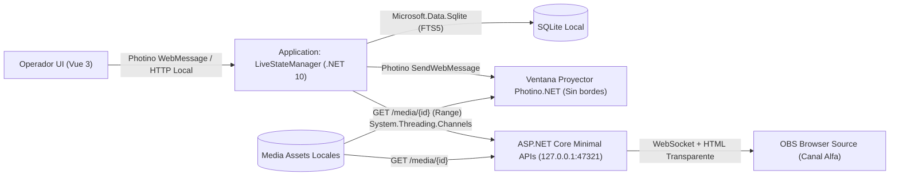
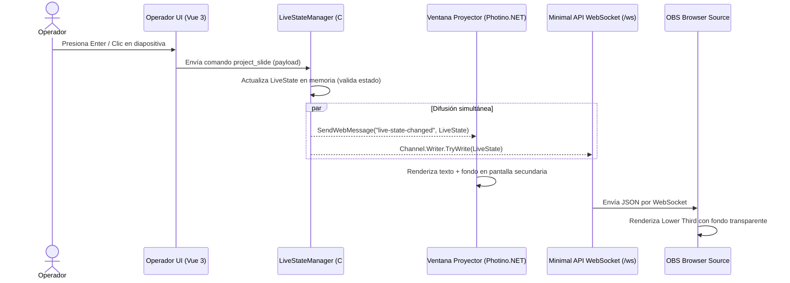

# ARCHITECTURE — Custom Presenter

## 1. Principios Arquitectónicos

La aplicación sigue **Clean Architecture / Arquitectura Hexagonal (Ports & Adapters)** sobre **.NET 10 LTS (C#)**, manteniendo la regla de dependencia hacia el interior: el **Dominio** no tiene dependencias de Photino.NET, ASP.NET Core, `Microsoft.Data.Sqlite` ni del frontend Vue 3.

- **Núcleo único de verdad (*Single Source of Truth*):** El estado en vivo (*Live State*: diapositiva actual, estado de *clear/blackout/logo*, tema activo) reside en memoria dentro de la capa de Aplicación en C# y se difunde de forma reactiva mediante `System.Threading.Channels` / suscriptores hacia las ventanas Photino.NET (Operador y Proyector Nativo) y el micro-servidor ASP.NET Core para OBS.
- **Bajo consumo:** Un único proceso principal .NET aloja la ventana de escritorio Photino.NET, el motor SQLite embebido (`Microsoft.Data.Sqlite`) y el servidor Kestrel minimalista en `127.0.0.1:47321`.

---

## 2. Stack Tecnológico Justificado

| Capa / Componente | Tecnología elegida | Justificación |
| :--- | :--- | :--- |
| **Shell de Escritorio** | **Photino.NET** | Wrapper nativo ultra ligero que usa el WebView del SO (WKWebView en macOS, WebView2 en Windows, WebKitGTK en Linux), evitando la sobrecarga de Electron o JVM. |
| **Backend Core** | **C# (.NET 10 LTS)** | Plataforma moderna, multiplataforma y de alto rendimiento; excelente soporte asíncrono (`async/await`, `Channels`) para baja latencia sin competir con OBS. |
| **Frontend UI / Vistas** | **Vue 3 + TypeScript** (Vite) | Composition API con reactividad granular (`ref`/`computed`) y bundle ligero para renderizado fluido a 60 fps en proyector y OBS. |
| **Estilos** | **CSS nativo + Variables CSS** | Cero sobrecarga de runtime CSS-in-JS; tematización dinámica instantánea para Proyector y OBS Overlay. |
| **Base de Datos** | **SQLite (`Microsoft.Data.Sqlite` + FTS5)** | Embebida, cero configuración, transacciones ACID y búsqueda de texto completo (FTS5) en `< 30 ms` sobre cientos de miles de versículos. |
| **Micro-servidor OBS** | **ASP.NET Core Minimal APIs + WebSockets (Kestrel)** | Integrado en el mismo proceso .NET, enlazado estrictamente a `127.0.0.1:47321` para servir la ruta `/obs` con canal alfa y `/media/{id}`. |
| **Parsing de Importación** | `XmlReader` (seguro) + `System.Text.Json` | Incluidos en la BCL de .NET; permiten streaming de bajo consumo de memoria para Biblias XML (OpenSong/Zefania) y respaldos JSON. |

---

## 3. Capas de la Arquitectura Hexagonal

1. **Domain (`src/CustomPresenter.Domain/`):**
   - Entidades puras: `Song`, `Slide`, `BibleVerse`, `Announcement`, `Playlist`, `PlaylistItem`, `ThemeConfig`, `LiveState`, `MediaAsset`.
   - Reglas de negocio puras: división de letras en diapositivas, validación de referencias bíblicas, transiciones de estado en vivo (*Live*, *Clear*, *Blackout*, *Logo*).
   - **Ports (Interfaces):** `ISongRepository`, `IBibleRepository`, `IAnnouncementRepository`, `IPlaylistRepository`, `IMediaStorage`, `ILiveBroadcaster`.
2. **Application (`src/CustomPresenter.Application/`):**
   - Casos de uso (*Use Cases*): `ProjectSlideUseCase`, `ToggleLiveFlagUseCase`, `SearchContentUseCase`, `ImportBibleUseCase`, `ManagePlaylistUseCase`, `RegisterMediaUseCase`.
   - Gestor de estado en vivo (`LiveStateManager`) que actualiza el estado y notifica a todos los `ILiveBroadcaster` suscritos.
3. **Infrastructure (`src/CustomPresenter.Infrastructure/`):**
   - **Persistencia (`Sqlite/`):** Implementación de repositorios con `Microsoft.Data.Sqlite`, migraciones embebidas e índices FTS5.
   - **Almacenamiento (`Storage/`):** Gestión segura de la carpeta local de assets (`media/`), validación de archivos y prevención de *path traversal*.
   - **Micro-servidor (`ObsServer/`):** Host Kestrel (ASP.NET Core Minimal APIs) en `127.0.0.1:47321` (puerto fijo por defecto, configurable en ajustes si está ocupado) con:
     - `GET /obs`: HTML/JS/CSS estático con fondo `rgba(0,0,0,0)` transparente.
     - `GET /ws`: WebSocket que envía el `LiveState` inicial y cada actualización en JSON.
     - `GET /media/{id}`: Servicio seguro de imágenes/videos locales por UUID opaco (con soporte de `Range` requests para video).
   - **Importadores (`Importers/`):** Adaptadores para XML (OpenSong/Zefania), TXT y JSON.
4. **Presentation / Interface (`src/CustomPresenter.Desktop/` & `frontend/`):**
   - **Photino Window Manager:** Gestión de ventanas nativas (`operator` y `projector` sin bordes en monitor destino) y puente IPC (`WebMessageReceived` / `SendWebMessage`).
   - **Frontend Vue 3 (`frontend/`):** Tres vistas desacopladas servidas por Vite / embebidas:
     - Vista **Operador** (panel de control, búsqueda, playlist, preview/live).
     - Vista **Proyector** (ventana Photino secundaria, pantalla completa sin bordes).
     - Vista **OBS Overlay** (servida por Minimal APIs en `/obs`, con canal alfa real).

---

## 4. Estructura de Carpetas Propuesta

```text
custom-presenter/
├── docs/                                   # Documentación (PRD, ARCHITECTURE, SECURITY, BACKLOG)
├── CustomPresenter.sln                     # Solución .NET 10 LTS
├── src/
│   ├── CustomPresenter.Domain/             # Entidades, Value Objects e Interfaces (Ports)
│   ├── CustomPresenter.Application/        # Casos de uso, DTOs y LiveStateManager
│   ├── CustomPresenter.Infrastructure/     # Microsoft.Data.Sqlite (FTS5), Minimal APIs OBS, Storage, Importers
│   └── CustomPresenter.Desktop/            # Photino.NET host, Window Manager y composición DI
├── tests/
│   ├── CustomPresenter.UnitTests/          # Pruebas unitarias (xUnit) de Dominio y Aplicación
│   └── CustomPresenter.IntegrationTests/   # Pruebas de integración (SQLite, Minimal APIs, Seguridad)
└── frontend/                               # Frontend Vue 3 + TypeScript (Vite)
    ├── src/
    │   ├── components/                     # Componentes UI reutilizables
    │   ├── stores/                         # Estado reactivo Vue (IPC Photino / WebSocket)
    │   ├── types/                          # Contratos TypeScript sincronizados con DTOs C#
    │   ├── views/
    │   │   ├── operator/                   # Interfaz principal de control
    │   │   ├── projector/                  # Renderizador de salida nativa sin bordes
    │   │   └── obs/                        # Renderizador ligero con fondo transparente para OBS
    │   └── main.ts
    ├── tests/                              # Pruebas unitarias frontend (Vitest)
    └── package.json
```

---

## 5. Flujo de Datos y Diagramas

### 5.1 Arquitectura de Componentes y Salidas Duales



### 5.2 Caso de Uso: Proyectar Diapositiva en Vivo (Baja Latencia)



---

## 6. Estrategia Multimedia y Compatibilidad Cross-Platform

- **Windows (WebView2) & macOS (WKWebView):** Soportan de forma nativa MP4 (H.264/AAC) y WebM (VP9).
- **Linux (WebKitGTK + GStreamer):** Requiere que los videos estén en formatos con decodificadores disponibles en GStreamer (`gst-libav` / `gst-plugins-good`), priorizando **WebM (VP9)** o **MP4 (H.264)**.
- **Optimización de recursos:**
  - La vista de **OBS (`/obs`)** no carga videos de fondo pesados por defecto (solo texto/estilos con canal alfa), manteniendo el uso de GPU/CPU de la Fuente de Navegador al mínimo.
  - Cuando el operador activa **Pantalla Negra (*Blackout*)** o **Logo**, los elementos `<video>` de fondo pausan su decodificación si no son visibles, liberando ciclos de CPU/GPU para OBS.
